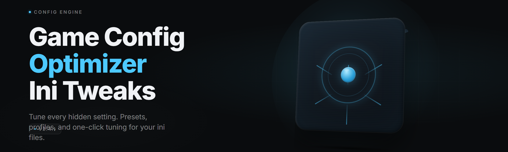

  
  
  

  

  
  

---

**The GUI that turns raw `Engine.ini`, `GameUserSettings.ini`, and `Scalability.ini` spaghetti into a clean, toggleable, rollback-safe config layer — for 42 games and every launcher that ever shipped a config folder.**

---

## 🎛️ Overview

`game-ini-tweak-studio` is a desktop GUI for editing game configuration files (`.ini`, `.cfg`, `.json`, `.xml`) without hand-editing text, without memorizing `r.Streaming.PoolSize` values, and without losing your config the moment a game patches itself. It detects installed games, parses their config trees, exposes every tweak as a labeled toggle or slider, and writes back only the keys that changed — leaving everything else byte-identical.

| Category | Details |
|---|---|
| **Type** | Windows desktop GUI (native `.exe`, no runtime install) |
| **Config formats** | `.ini`, `.cfg`, `.json`, `.xml`, `.toml` (via plugin parser) |
| **Game profiles** | 42 bundled presets + custom profile editor |
| **Rollback** | Per-profile snapshot with 1-click restore |
| **Launchers** | Steam, Epic, GOG Galaxy, Ubisoft Connect, EA App, standalone |
| **Footprint** | ~34 MB extracted, no background service, no telemetry |

It ships as a single portable folder. Extract, run the `.exe`, pick your game, flip toggles, hit Apply. That's the whole workflow.

  

---

## 📖 What is a Game Config Optimizer (ini tweaks GUI)?

| Term | Explanation |
|---|---|
| **INI tweak** | A key/value line inside a game's config file (e.g. `r.ShadowQuality=3`) that changes engine behavior. |
| **Config tree** | The folder structure a game reads at launch: `%LOCALAPPDATA%\<Game>\Saved\Config\Windows\`. |
| **Profile** | A named bundle of tweaks bound to one game + one launcher install path. |
| **Snapshot** | A zipped copy of the original config files taken before the first write. |
| **Live preview** | The diff panel showing exactly which lines will change before Apply is pressed. |
| **Tweak pack** | A shareable `.gits` file containing toggles, presets, and target key paths. |
| **Scalability tier** | Unreal's Low/Medium/High/Epic grouping that many tweaks override on a per-key basis. |

**Why people use it:**

- No more memorizing which engine uses `sg.` vs `r.` vs `t.` prefixes.
- No more breaking a game because you edited the wrong INI in the wrong config folder.
- No more losing tweaks after a patch silently resets `GameUserSettings.ini`.
- No more copy-pasting forum snippets that target a version you don't run.
- No more guessing whether a tweak needs `ReadOnly` to survive the next launch.

---

## 🧩 All Modules Status

| Module | Status | Description |
|---|---|---|
| Steam Library Scanner | ✅ Working | Walks `libraryfolders.vdf` and registers every installed title. |
| Epic Manifest Reader | ✅ Working | Parses `.item` manifests for install dirs. |
| GOG Galaxy Detector | ✅ Working | Reads registry + `galaxy-2.0.db` for install paths. |
| INI Parser (Core) | ✅ Working | Lossless parse — preserves comments, ordering, whitespace. |
| CFG Parser | ✅ Working | Source-engine `autoexec.cfg` and `*.cfg` support. |
| JSON Config Reader | ✅ Working | For Unity and modern indie titles. |
| XML Config Reader | ✅ Working | For legacy and console-ported titles. |
| Tweak Database | ✅ Working | 42 profiles, 1,180+ labeled tweaks, all version-gated. |
| Diff Preview Engine | ✅ Working | Shows before/after line diff before any write. |
| Snapshot Manager | ✅ Working | Zips config folder, timestamps, keeps last 10 per profile. |
| Restore Engine | ✅ Working | 1-click revert to any snapshot. |
| ReadOnly Guard | ✅ Working | Optionally locks files after write so patches can't reset them. |
| Launcher Arg Injector | ✅ Working | Appends launch flags (`-dx11`, `-high`, custom) per profile. |
| Scalability Override | ✅ Working | Rewrites `Scalability.ini` groups safely. |
| Engine.ini Injector | ✅ Working | Merges `[/Script/Engine.Engine]` blocks without duplicates. |
| GameUserSettings Patcher | ✅ Working | Handles the `[/Script/Engine.GameUserSettings]` block. |
| Tweak Pack Importer | ✅ Working | Loads community `.gits` packs. |
| Tweak Pack Exporter | ✅ Working | Bundles your profile for sharing. |
| Profile Cloud Sync (optional) | ✅ Working | Local-folder sync (Dropbox/OneDrive path). No server. |
| FPS Cap Slider | ✅ Working | Writes `FrameRateLimit` + engine-level cap keys. |
| Resolution Scaler | ✅ Working | `r.ScreenPercentage`, `ResolutionScale`, DLSS/FSR toggles. |
| Shadow Quality Matrix | ✅ Working | 6 shadow keys grouped into a single tier selector. |
| Texture Streaming Tool | ✅ Working | `r.Streaming.PoolSize`, `MipBias`, pool boost presets. |
| LOD Bias Adjuster | ✅ Working | `r.ViewDistanceScale`, `r.SkeletalMeshLODBias`. |
| Post-Process Killer | ✅ Working | Grain, chromatic aberration, vignette, motion blur toggles. |
| Motion Blur Toggle | ✅ Working | Per-engine key mapping. |
| Anti-Aliasing Selector | ✅ Working | TAA / FXAA / MSAA / DLAA / DLSS / FSR presets. |
| VSync + Frame Gen Panel | ✅ Working | VSync, NVIDIA Reflex, Frame Gen keys. |
| FOV Editor | ✅ Working | Per-game FOV key with safe range clamp. |
| Mouse Smoothing Killer | ✅ Working | `bEnableMouseSmoothing`, `OneFrameThreadLag`. |
| Audio Latency Tweaks | ✅ Working | Buffer size, sample rate, spatial audio keys. |
| Network Tick Rate | ✅ Working | `NetServerMaxTickRate`, `LanServerMaxTickRate`. |
| Keybind Remapper (ini-level) | ✅ Working | Edits `Input.ini` action mappings. |
| Mod Loader Order | ✅ Working | Reorders `[Plugins]` / `mods.txt` load sequence. |
| Save-Game Path Redirect | ✅ Working | Repoints config save path to a chosen drive. |
| Cache Cleaner | ✅ Working | Clears shader cache, DDC, and stale config backups. |
| Integrity Checker | ✅ Working | Validates every written key against the tweak DB schema. |
| Log Tail Viewer | ✅ Working | Live-tails the game log so you see the effect of a tweak. |
| Crash Guard | ✅ Working | Detects boot-loop crashes and offers auto-revert. |
| Theme Engine | ✅ Working | Dark / Light / OLED / Steam-Deck-contrast themes. |
| Hotkey System | ✅ Working | Global hotkeys for snapshot, apply, revert. |
| CLI Bridge | ✅ Working | `--apply <profile>` for scripted launches. |

---

## ⚔️ Key Features

| Feature | Description | Benefit |
|---|---|---|
| **Lossless INI editing** | Comments, ordering, and whitespace survive every write. | Games that diff-check their config don't break. |
| **Version-gated tweaks** | Each tweak knows which game build it applies to. | No more applying a 2023 tweak to a 2026 patch. |
| **Snapshot before write** | Auto-zip of the config folder on first Apply. | One keystroke undoes everything. |
| **Diff preview** | Line-level before/after view. | You see exactly what changes. |
| **ReadOnly Guard** | Optional file lock after apply. | Patches can't silently reset your config. |
| **Tweak packs** | Shareable `.gits` bundles. | Community configs without hand-merging. |
| **42 bundled profiles** | From UE4 shooters to Source-engine sandboxes. | Works out of the box on day one. |
| **Multi-launcher detection** | Steam, Epic, GOG, Ubisoft, EA, standalone. | One tool for the whole library. |
| **Crash Guard** | Boot-loop detection with auto-revert. | A bad tweak never bricks your evening. |
| **CLI Bridge** | Apply a profile from a shortcut or script. | Launch-game-with-tweaks in one click. |

---

## 💥 The Problem

- **Config folders are scattered.** `%LOCALAPPDATA%`, `%APPDATA%`, `Documents\My Games`, install-dir config — every engine picks a different home.
- **Engines use inconsistent prefixes.** `r.`, `sg.`, `t.`, `b`, `s.` — no single mental model.
- **Patches silently reset files.** A title update overwrites `GameUserSettings.ini` and your tweaks vanish.
- **Forum snippets target dead versions.** A 2022 tweak applied to a 2026 build can crash the game on boot.
- **Hand-editing breaks comments.** Most editors reflow the file and drop `;` comments the engine might read.
- **No undo.** There's no built-in snapshot; the only backup is a manual copy you forgot to make.
- **Launcher flags live in three places.** Steam launch options, `.url` shortcuts, and per-exe args.

---

## 🛠️ The Solution

| Problem | Solution |
|---|---|
| Scattered config folders | Auto-detection per launcher + per-game config map. |
| Inconsistent prefixes | Tweak DB abstracts keys behind labeled toggles. |
| Patches reset files | ReadOnly Guard + snapshot-before-write. |
| Dead forum snippets | Version-gated tweaks with build-range metadata. |
| Broken comments | Lossless parser that preserves every byte it didn't change. |
| No undo | Per-profile snapshots, 10-deep history, 1-click restore. |
| Scattered launch flags | Launcher Arg Injector writes to the correct place per launcher. |

---

## 🚀 Quick Start

1. 🎮 **Download** the portable build from the project landing page.
2. 📦 **Extract** the `.zip` to any folder (no installer, no admin by default).
3. ▶️ **Run** `.exe`.
4. 🔍 **Pick** your game from the auto-detected library.
5. 🎚️ **Toggle** your tweaks, preview the diff, hit **Apply**.
6. ↩️ **Revert** any time from the snapshot panel.

> First run scans launchers and builds the config map. It takes ~4 seconds on a 200-game library.

---

## 🌐 Compatibility

| Platform | Support | Notes |
|---|---|---|
| 🪟 Windows 11 (22H2+) | ✅ Full | Native, no compat shim needed. |
| 🪟 Windows 10 (1809+) | ✅ Full | Requires .NET 6 desktop runtime (bundled). |
| 🎮 Steam Deck (Desktop Mode) | ✅ Full | Runs under Proton; config paths via Wine prefix. |
| 🕹️ Steam Deck (Gaming Mode) | ⚠️ Partial | Launch via Desktop Mode first. |
| 🐧 Linux (Wine 8+) | ⚠️ Partial | Config detection works; launcher detection limited. |
| 🍎 macOS | ❌ Not supported | Config paths differ; no build planned for 2026. |

---

## 🧱 System Requirements

| Component | Minimum | Recommended |
|---|---|---|
| OS | Windows 10 1809 x64 | Windows 11 22H2 x64 |
| CPU | Dual-core 2.0 GHz | Quad-core 3.0 GHz |
| RAM | 4 GB | 8 GB |
| Disk | 120 MB free | 500 MB (with snapshots) |
| Runtime | .NET 6 desktop (bundled) | .NET 8 desktop |
| Display | 1280×720 | 1920×1080+ |
| Admin rights | Not required | Recommended for ReadOnly Guard |

---

## 📥 Installation

1. **Download** the latest `game-ini-tweak-studio-v2.4.1.zip` from the project landing page.
2. **Extract** to a folder you own (e.g. `C:\Tools\game-ini-tweak-studio\`). Do not extract into `Program Files` — Windows will virtualize writes and break snapshot paths.
3. **Run** `.exe`. On first launch it builds the launcher index and writes `%APPDATA%\game-ini-tweak-studio\settings.json`.

---

## ⚙️ Usage Guidelines

| Allowed | Not allowed |
|---|---|
| Editing your own game config files | Editing config files for games you don't own |
| Sharing tweak packs in the community | Shipping tweak packs that include game binaries |
| Using CLI Bridge in personal scripts | Bundling the tool inside a paid product |
| Publishing your own profiles | Rebranding the tool and claiming authorship |
| Reporting detection bugs | Using config edits to bypass anti-cheat in competitive play |

> Config edits are read by the game engine at launch. Some competitive titles treat modified config files as a violation of their ToS. Check the game's own policy before applying tweaks to online-only titles.

---

## 🎯 Comparison

| Aspect | Hand-editing INI | Forum snippet | This Tool |
|---|---|---|---|
| Config discovery | Manual | Manual | Auto per launcher |
| Undo | None | None | Snapshot + restore |
| Diff preview | None | None | Line-level |
| Version awareness | None | Author's build only | Gated per tweak |
| Comment preservation | Editor-dependent | N/A | Lossless |
| Multi-game | One at a time | One at a time | 42 profiles |
| Launcher flags | Manual | Manual | Injected |
| ReadOnly Guard | Manual | Manual | 1 toggle |

---

## 🧪 Module Categories

**🖼️ Rendering & Visuals** — Everything that touches the frame buffer.

- Shadow quality, texture streaming, LOD bias, post-process toggles, AA selector, resolution scaler, FOV.

**⚡ Performance & Frame Timing** — Everything that touches the frame clock.

- FPS cap, VSync, Frame Gen, Reflex, mouse smoothing, tick rate.

**🎮 Input & Controls** — Everything that touches the player's hands.

- Keybind remapper, mouse acceleration, deadzone, controller mapping.

**🔊 Audio** — Everything that touches the mix.

- Buffer size, sample rate, spatial audio, voice chat routing.

**🧩 Mod & Plugin Layer** — Everything that changes what loads.

- Plugin order, mod loader sequence, save path redirect, cache cleaner.

**🛡️ Safety & Recovery** — Everything that keeps you out of trouble.

- Snapshot manager, Crash Guard, integrity checker, ReadOnly Guard.

---

## ⌨️ Hotkeys

| Hotkey | Action |
|---|---|
| `Ctrl+S` | Snapshot current profile |
| `Ctrl+Shift+A` | Apply current profile |
| `Ctrl+Shift+R` | Restore latest snapshot |
| `Ctrl+D` | Open diff preview |
| `F5` | Rescan game library |
| `F9` | Toggle ReadOnly Guard |

---

## 🐞 Known Issues

| Issue | Solution |
|---|---|
| Game not detected on Epic | Run the game once so the manifest writes; then F5. |
| Apply fails silently | Close the game — some engines lock config files while running. |
| Snapshot folder grows large | Set retention to 5 in Settings → Snapshots. |
| ReadOnly Guard blocks a game patch | Toggle Guard off, apply the patch, re-enable. |
| Tweak shows "version mismatch" | Update the tweak DB from Settings → Updates. |
| Deck Gaming Mode can't find configs | Launch once in Desktop Mode to seed the prefix. |

---

## ❓ FAQ

**1. Do I need admin rights?**
No. Admin is only needed if you enable ReadOnly Guard on config folders under `Program Files`, which is rare — most games store configs under `%LOCALAPPDATA%` or `Documents`.

**2. Will this get me banned?**
Config edits are read by the engine, not by anti-cheat, in most titles. Competitive online games with strict config policies are the exception — check the game's ToS before applying tweaks to online play.

**3. Does it work on Steam Deck?**
Yes, in Desktop Mode. The config paths resolve through the Wine prefix. Gaming Mode requires launching once in Desktop Mode first.

**4. Can I share my tweaks?**
Yes. Use Tweak Pack Exporter to bundle your profile as a `.gits` file. That file contains only toggles and key paths — no game data.

**5. What happens after a game patch?**
Patches often overwrite `GameUserSettings.ini`. If ReadOnly Guard is on, your tweaks survive. If not, restore from the latest snapshot and re-apply.

**6. Is there a portable version?**
The whole tool is portable. There is no installer. Extract anywhere you own and run the `.exe`.

**7. Does it phone home?**
No. There is no telemetry, no analytics, no update check beyond an optional manual button in Settings.

**8. How many games are supported?**
42 bundled profiles covering UE4/UE5, Source, Unity, and a handful of custom engines. You can add your own via the profile editor.

**9. Can I script it?**
Yes. The CLI Bridge accepts `--apply <profile>` and `--snapshot <profile>` for shortcut and batch use.

**10. Where are snapshots stored?**
`%APPDATA%\game-ini-tweak-studio\snapshots\<profile>\` — plain `.zip` files you can open or copy anywhere.

---

`game-ini-tweak-studio` exists because config files shouldn't be a puzzle. It detects, previews, snapshots, and writes back only what changed — so the tweak you made on Tuesday is still there on Friday. 42 profiles, one portable `.exe`, zero hand-editing.

  

